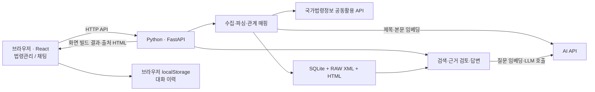
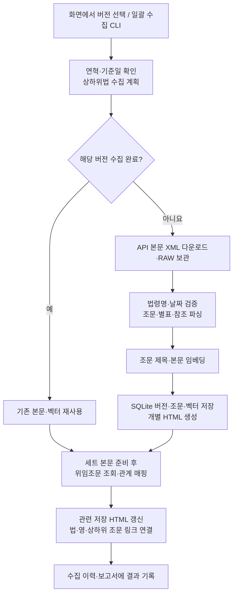
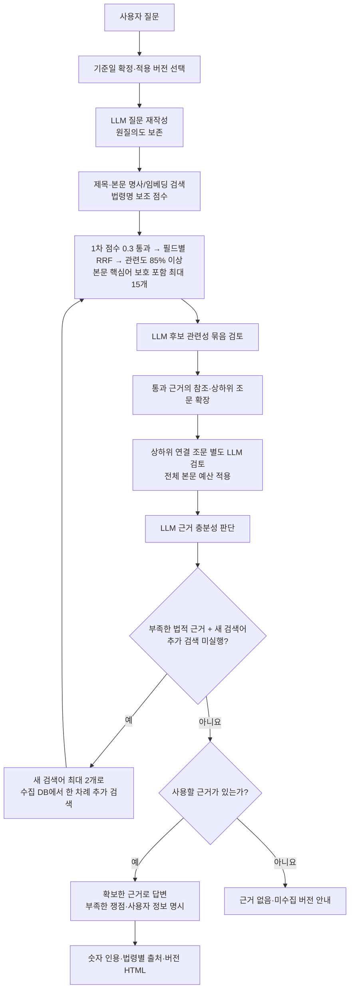

# LawRAG

국가법령정보 공동활용 API에서 법령·행정규칙을 수집하고, 질문과 관련된 조문을 검색해 근거와 함께 답변하는 RAG 앱입니다. **Python/FastAPI 백엔드**, **React/Vite 프론트엔드**, **SQLite 저장소**로 구성합니다.

1. [전체 코드 구성](#1-전체-코드-구성)
2. [사용하기 위해 필요한 설정](#2-사용하기-위해-필요한-설정)
3. [법령 수집 구조 및 저장 구조](#3-법령-수집-구조-및-저장-구조)
4. [검색 파이프라인 구조](#4-검색-파이프라인-구조)

## 1. 전체 코드 구성

### 구성 요소와 실행 방식



프론트엔드 빌드 결과를 저장소의 `app/static/`에 포함합니다. **실행만 할 때는 Node.js 없이 Python 서버 하나로 사용**하며, 화면을 개발할 때 Node.js와 Vite를 사용합니다. 글꼴은 로컬에 포함한 Pretendard Variable입니다.

```text
LawRAG/
├─ app/                       Python 백엔드와 수집·관리 CLI
│  ├─ main.py                 FastAPI 앱, API 경로, 화면·문서 제공
│  ├─ serve.py                로컬/내부망 서버 실행
│  ├─ config.py               .env 로딩과 공통 설정
│  └─ static/                 React 빌드 결과
├─ frontend/
│  ├─ src/                    React 화면 소스
│  ├─ vite.config.js          빌드 경로와 개발 서버 프록시
│  └─ licenses/               글꼴 라이선스
├─ data/                      DB·원문·HTML·작업 보고서 (Git 제외)
├─ docs/                      운영 명령과 세부 설계 문서
├─ tests/                     백엔드·API·브라우저 회귀 검사
├─ .env.example               환경 변수 예시
├─ local.env.example          사내 AI 서버 연결·선택 예시
├─ local.env.vllm.example     GPT + bge-m3-ko vLLM 직접 임베딩 설정
├─ requirements.txt           Python 의존성
├─ collect_current_laws.cmd   현행 법률·하위법 일괄 수집
├─ collect_current_admrul.cmd 현행 행정규칙 일괄 수집
└─ law_article_links.py       단일 XML → 조문·별표 링크 HTML 변환기
```

### 백엔드: 기능별로 읽을 파일

| 기능 | 주요 코드 | 역할 |
| --- | --- | --- |
| HTTP 진입점 | [main.py](app/main.py) | 요청 검증, 검색·채팅 API, 단계 스트림, 출처 HTML 제공 |
| 수집 관리 | [management.py](app/management.py) | 이름·버전 조회, 수집 계획·큐·이력, 재색인 |
| API·본문 파싱 | [laws.py](app/laws.py), [admrul_parser.py](app/admrul_parser.py) | API 호출, XML/행정규칙 본문 파싱, HTML 생성 |
| 상하위법 수집 | [hierarchy.py](app/hierarchy.py) | 공식 체계도 해석, 함께 수집할 법률·시행령·시행규칙 버전 선택 |
| 위임조문 | [delegation.py](app/delegation.py) | 위임조문 3단비교 파싱, 버전 검증, 조문 간 관계 저장 |
| 저장·색인 | [store.py](app/store.py), [embedding_inputs.py](app/embedding_inputs.py) | SQLite·원문 보관, 제목/본문 벡터 저장, 긴 임베딩 입력 분할 |
| 검색 점수 | [retrieval.py](app/retrieval.py), [keywords.py](app/keywords.py) | 명사 일치·벡터 비교, 법령명 보조 점수, RRF, 후보 선정 |
| 기준일·참조 확장 | [temporal.py](app/temporal.py), [graph.py](app/graph.py) | 적용 버전 선택, 참조·역참조·별표·정의·상하위 조문 확장 |
| 답변 흐름 | [chat_pipeline.py](app/chat_pipeline.py), [evidence_review.py](app/evidence_review.py) | 후보 검토, 연결 조문 검토, 충분성 판단, 추가 검색, 답변 |
| AI 연동 | [ai_endpoints.py](app/ai_endpoints.py), [provider.py](app/provider.py), [http_retry.py](app/http_retry.py), [nse_mq.py](app/nse_mq.py) | OpenAI/사내 HTTP·NSE MQ 선택, 채팅·임베딩 호출, 응답 검증·스트리밍 |
| HTML 링크 | [references.py](app/references.py), [document_links.py](app/document_links.py) | 조문·별표 참조 추출, 법/영 약칭 해석, 문서 간 링크 |
| 일괄 수집 | [preload_maritime.py](app/preload_maritime.py), [preload_admrul.py](app/preload_admrul.py) | 지정 법률·행정규칙 목록 수집 및 중단 후 재개 |

현재 웹 검색은 `Store.search_enhanced()` → `retrieval.search()`를 사용합니다. `store.py`의 이전 `Store.search()`와 구분합니다.

### 프론트엔드와 API 연결

| 화면 | 소스 | 사용하는 기능 |
| --- | --- | --- |
| 공통 화면·출처 팝업 | [main.jsx](frontend/src/main.jsx), [style.css](frontend/src/style.css) | 법령관리/채팅 전환, 법령 HTML 열기 |
| 법령관리 | [LawManagement.jsx](frontend/src/LawManagement.jsx), [CollectionDialog.jsx](frontend/src/CollectionDialog.jsx) | 카테고리, 이름·버전 조회, 상하위법 확인, 수집 상태 |
| 채팅 | [Chat.jsx](frontend/src/Chat.jsx) | 질문·모델 선택, 현재 처리 단계, 출처, 브라우저 대화 이력 |
| 답변 표시 | [AnswerMarkdown.jsx](frontend/src/AnswerMarkdown.jsx) | Markdown, 표·목록, LaTeX 수식(remark-math·KaTeX), 숫자 인용과 지식출처 연결 |

주요 경로는 `/api/management/*`(수집 관리), `POST /api/search`(검색), `POST /api/chat` 및 `/api/chat/stream`(검토·답변), `/documents/{파일명}`(출처)입니다. 실행 중인 서버의 `/openapi.json`에서 요청·응답 스키마를 확인할 수 있습니다.

## 2. 사용하기 위해 필요한 설정

### 실행 환경과 .env

Python **3.12**와 SQLite 확장 로드가 가능한 환경이 필요합니다. 화면 개발 시에는 Node.js 22 LTS 이상을 권장합니다. 법령 API와 설정한 AI API 서버에 접속할 수 있어야 합니다.

프로젝트 루트에서 `.env.example`을 `.env`로 복사하고 키를 입력합니다. **프로세스 환경 변수 > `local.env` > `.env`** 순으로 적용하며 변경 후 서버를 재시작합니다. `local.env`가 없으면 기존 `.env` 설정으로 동작합니다. 두 설정 파일과 기본 `data/`는 Git에서 제외합니다.

| 변수 | 기본값 | 용도 |
| --- | --- | --- |
| `LAW_API_OC` | 없음 | 국가법령정보 공동활용 OC 식별값. 사용할 법령·체계도·위임조문·행정규칙 API 권한 필요 |
| `LLM_API_KEY` | 없음 | AI API 키. 미설정이면 `OPENAI_API_KEY` 사용 |
| `LLM_BASE_URL` | `https://api.openai.com/v1` | Embeddings와 Chat Completions 호환 API 주소 |
| `EMBEDDING_MODEL` | `text-embedding-3-large` | 수집 조문과 검색 질문의 임베딩 모델 |
| `CHAT_MODEL` | `gpt-4.1` | 채팅창 초기 모델. 선택한 모델은 해당 요청의 재작성·검토·답변에 적용 |
| `SEARCH_CANDIDATE_LIMIT` | `15` | 채팅에서 검토할 검색 후보 수. 최대 15개로 제한 |
| `REFERENCE_LIMIT` | `40` | 한 차례 관계 확장의 추가 문서 수. 상한 80개 |
| `CONTEXT_MAX_CHARS` | `60000` | 최종 근거 본문 예산. 조문 중간을 자르지 않음 |
| `DATA_DIR` | 프로젝트 `data/` | DB·RAW·HTML·수집 보고서 저장 경로 |

### OpenAI와 회사 sLLM·임베딩 서버 함께 사용

채팅과 임베딩 서버를 **각각 독립적으로 선택**할 수 있습니다. 기본값은 둘 다 `openai`이며 기존 설정을 그대로 사용합니다. 사내 서버는 OpenAI 호환 `/chat/completions`, `/embeddings`와 NSE의 MQ 채팅(`LOCAL_MODEL`)을 지원합니다.

```powershell
if (!(Test-Path local.env)) { Copy-Item local.env.example local.env }
notepad local.env
```

| `CHAT_BACKEND` | `EMBEDDING_BACKEND` | 사용 조합 |
| --- | --- | --- |
| `openai` | `openai` | 기존 OpenAI 채팅 + 임베딩 |
| `company` | `openai` | 회사 sLLM + 기존 OpenAI 임베딩 |
| `openai` | `company` | OpenAI 채팅 + 회사 임베딩 |
| `openai` | `vllm` | 기존 GPT + bge-m3-ko 등 vLLM 임베딩 HTTP 직접 호출 |
| `company` | `company` | 채팅·임베딩 모두 회사 서버 |
| `local_model` | `openai` | NSE MQ 채팅 기본값 + 기존 OpenAI 임베딩. 채팅창에서 GPT도 선택 가능 |
| `openai` | `local_embedding` | 기존 GPT + NSE MQ 임베딩 (`LOCAL_EMBEDDING`) |
| `local_model` | `local_embedding` | 채팅·임베딩 모두 NSE MQ |

`local.env`에서 `COMPANY_CHAT_BASE_URL`, `COMPANY_CHAT_MODEL`, `COMPANY_EMBEDDING_BASE_URL`, `COMPANY_EMBEDDING_MODEL`에 주소·포트·모델을 지정합니다. 키는 서버별 `COMPANY_CHAT_API_KEY`, `COMPANY_EMBEDDING_API_KEY`로 분리하며, 비어 있으면 인증 헤더를 보내지 않습니다. 사내 연결에 OpenAI 키를 대신 보내거나 실패 시 OpenAI로 자동 전환하지 않습니다.

채팅만 변경하면 재임베딩이 필요 없습니다. **임베딩 서버·모델을 변경하면 기존 벡터와 혼합할 수 없으므로 재색인하거나 별도 `DATA_DIR`를 사용**합니다. 서버 선택은 서버 설정 단위이며, 채팅창의 모델 선택은 현재 선택된 채팅 서버 안에서만 이루어집니다. [설정 예시·API 요청/응답 형식·재색인 절차](docs/company_ai.md)를 참고하세요.

다른 채팅이나 프로젝트에 회사 sLLM 호출 부분만 전달하려면 [독립 Python 호출 코드 MD](docs/company_llm_python.md)를 사용하세요. 설정 파일, 일반 응답·SSE 스트리밍, 토큰 한도 확인, 실행 예제를 담고 있습니다.

**bge-m3-ko를 MQ 없이 직접 호출**하려면 [local.env.vllm.example](local.env.vllm.example)을 `local.env`로 복사합니다. `EMBEDDING_BACKEND=vllm`, `COMPANY_EMBEDDING_BASE_URL=http://127.0.0.1:8000/v1`, `COMPANY_EMBEDDING_MODEL=emb-bge-m3-ko`를 사용합니다. LawRAG 서버와 같은 PC에서 `kubectl --context=kdev-context -n davinci-ragllm port-forward svc/emb-bge-m3-ko-vllm-predictor 8000:80`을 실행해 두고 `python -m app.check_ai`로 임베딩만 확인합니다. [백업·포트 전달·재색인 실행 순서](docs/company_ai.md#bge-m3-ko-vllm-직접-연결)를 참고하세요. 채팅은 기존 GPT 설정을 유지합니다.

회사 vLLM 채팅은 `COMPANY_CHAT_MAX_TOKENS=auto`로 서버 문맥 한도와 실제 입력 토큰 수를 조회해 남은 길이를 출력 상한으로 사용합니다. 웹의 최종 답변은 `stream=true`의 SSE 청크를 받아 바로 표시하고, 내부 검토 JSON은 완성 후 검증합니다. `python -m app.check_ai --stream`으로 JSON 응답·토큰 예산·실제 스트리밍을 확인할 수 있습니다. [문맥 한도와 스트리밍 설정](docs/company_ai.md#vllm-채팅-실제-문맥-한도와-스트리밍)을 참고하세요.

회사 NSE의 **RabbitMQ 규약**은 `python -m app.check_nse_mq --connect-only`로 접속·큐를 확인하고, 옵션 없이 일반 응답, `--stream`으로 실제 청크, `--json`으로 JSON 생성, `--embedding`으로 임베딩을 검사합니다. MQ 설정을 추가하면 GPT를 유지하면서 채팅 모델 목록에서 `LOCAL_MODEL`도 선택할 수 있습니다. 요청은 `nse_request`, 응답은 요청마다 분리된 `nse_result_kih_<UUID>` 큐를 사용합니다. 임베딩은 `EMBEDDING_BACKEND=local_embedding`으로 별도 선택하며 `NSE_EMBEDDING_MODEL`에 `served_model_name`을 설정합니다. 기존 데이터는 재색인이 필요합니다. [NSE MQ 접속 설정과 PowerShell 실행 순서](docs/nse_mq.md)를 참고하세요.

웹 검색·채팅은 **RRF + 화면 관련도 85% 이상으로 고정**합니다. 내부 1차 후보 통과 점수는 0.3을 유지하고, RRF 계산 후 0.85 미만을 제외합니다. 기존 `SEARCH_FUSION`, `SEARCH_THRESHOLD`, `SEARCH_TITLE_WEIGHT`, `SEARCH_MIN_TITLE_SCORE`, `SEARCH_MIN_BODY_SCORE`는 현재 웹 검색에 사용하지 않습니다. 요약·예상 질문 생성용 `METADATA_MODEL`도 사용하지 않습니다.

### 최초 설치와 실행

저장소를 받은 뒤 **프로젝트 루트의 PowerShell**에서 실행합니다.

```powershell
py -3.12 -m venv .venv
.\.venv\Scripts\python.exe -m pip install -r requirements.txt
if (!(Test-Path .env)) { Copy-Item .env.example .env }
notepad .env
.\.venv\Scripts\python.exe -m app.serve
```

브라우저에서 `http://127.0.0.1:8001`을 엽니다. Linux/macOS에서는 가상환경의 `.venv/bin/python`을 사용합니다. 수집 큐와 잠금은 **단일 서버 프로세스**를 전제로 하므로 여러 `--workers`로 실행하지 않습니다.

### 업데이트와 내부망 실행

기존 서버와 수집 작업을 `Ctrl+C`로 종료한 뒤 실행합니다.

```powershell
git pull --ff-only origin main
if ($LASTEXITCODE -ne 0) { throw "git pull 실패" }
.\.venv\Scripts\python.exe -m pip install -r requirements.txt
.\.venv\Scripts\python.exe -m app.serve --lan
```

`--lan`은 모든 IPv4 인터페이스의 8001 포트에서 접속을 받습니다. `ipconfig`에서 회사망 IPv4 주소를 확인해 `http://서버IP:8001`로 접속합니다. 예를 들어 서버 IP가 `10.224.64.143`이면 **`http://10.224.64.143:8001`**입니다. `0.0.0.0`은 접속 주소가 아닙니다. 포트는 `--port 8002`로 변경할 수 있습니다.

| 항목 | 공유 범위 |
| --- | --- |
| 법령 DB·수집 상태·관리 기능·서버 API 설정 | 서버에 접속한 사용자 전체 |
| 채팅 제목·질문·답변 | 브라우저 localStorage에 저장. 서버에는 대화 이력을 저장하지 않음 |
| 로그인 없는 이력 구분 | 브라우저 프로필과 접속 주소·포트 단위. 사용자 계정 단위의 권한 분리는 아님 |

같은 브라우저 프로필을 공유하면 이력도 공유합니다. 사이트 데이터를 지우면 이력이 사라지고, 로컬 주소와 내부 IP로 접속한 이력은 서로 다릅니다. 모든 접속자가 법령관리 기능을 사용할 수 있으므로 내부망 운영 범위를 기준으로 접근을 설정합니다.

[Windows 방화벽 설정·AI 연결 진단·프론트엔드 개발·검증 명령](docs/operations.md)은 운영 문서에 정리했습니다.

## 3. 법령 수집 구조 및 저장 구조

### 수집 흐름



위 흐름은 법령 세트 수집 기준입니다. 행정규칙은 별도로 본문을 수집·파싱·임베딩하며, 상위 법령 동반 수집과 관계 자동 매핑은 수행하지 않습니다.

관리 화면에서는 **수집하기 → 이름 검색 → 버전 조회·선택 → 상하위법 확인 → 함께 수집 시작** 순서로 진행합니다. 이름·연혁 조회만으로 임베딩하지 않으며 수집을 시작해야 본문과 벡터를 저장합니다. 왼쪽 카테고리는 **실제 조문 행이 저장된 법령만** 표시합니다. RAW/HTML만 지우고 DB를 남기면 카테고리도 남습니다.

### API 조회와 버전 선택

| 대상 | API / 처리 방식 |
| --- | --- |
| 법령 연혁·현행 | `lawSearch.do`, `target=eflaw`. 일련번호(MST) + 시행일로 구분하고 선택한 정확한 법령명으로 필터링 |
| 법령 본문 | `lawService.do?target=eflaw&MST=...&efYd=...`. 응답 법령명·시행일이 요청과 다르면 저장하지 않음 |
| 상하위법 체계도 | `lawService.do?target=lsStmd&MST=...&type=JSON`. 공식 부모·자식 관계 사용 |
| 위임조문 3단비교 | `lawService.do?target=thdCmp&MST=...&knd=2&type=JSON`. 법률·시행령·시행규칙의 조문 관계 추출 |
| 행정규칙 | `target=admrul`. 현행 검색과 본문 조회를 별도로 수행 |

동반 수집 대상은 **법률·시행령·시행규칙 세 종류**입니다. 이름이 본법과 다르더라도 공식 체계도에 있는 하위 규칙이면 포함하며, 하위 규칙이 여러 개면 모두 검토합니다. 행정규칙은 자동으로 함께 받지 않습니다.

- **화면에서 선택한 버전 수집**: 선택 버전의 적용 기간과 체계도의 MST·시행일·공포일을 확인합니다. 동반 항목의 정보가 없거나 기간 밖이면 연혁으로 보완합니다. 현재 선택 버전은 오늘, 과거 버전은 다음 개정 직전을 묶음의 기준일로 사용합니다.
- **현행 일괄 수집**: 실행일의 한국 날짜를 기준으로 본법과 하위법 각각의 현행 검색 결과를 확인해 현재 시행 중인 최신 버전 하나씩 선택합니다. 더 오래 시행된 상위법도 현재 유효하면 포함하며 미래 시행·공포 버전은 제외합니다.

수집 완료한 버전은 재사용합니다. 한 구성 법령만 개정되면 새 버전의 본문·벡터를 추가하고, 기존 시행령·시행규칙 등의 **HTML 참조 대상도 다시 계산**합니다. 본문 수집과 위임관계 조회 결과는 별도로 기록하므로 관계 조회 실패만으로 완료한 본문을 재임베딩하지 않습니다.

### 파싱·임베딩 범위

| 자료 | 보관·검색 방식 |
| --- | --- |
| 조문 제목 | `법령명 - 조번호(조문 제목)`을 임베딩. 제목 키워드 검색은 조문 제목만 비교 |
| 조문 본문 | 본문 시작의 중복 조 제목을 제거한 내용으로 임베딩. 답변·HTML에는 조 전체 원문 유지 |
| 법령명 | 독립 벡터를 추가 생성하지 않음. 제목 벡터에 포함하고 명사 일치 보조 점수로도 사용 |
| 요약·역생성 질문 | 생성·임베딩·검색하지 않음 |
| 별표·별지 서식 | 조문 벡터로 임베딩하지 않음. 별표 텍스트·참조·공식 파일 주소는 보관하고 연결 |
| 번호만 남은 이동 조문 | XML·HTML·DB에는 보관하되 임베딩·검색에서 제외 |

“별지 제1호서식을 제출해야 한다” 같은 조문 본문의 의무는 검색 대상입니다. 행정규칙은 구조화된 XML뿐 아니라 CDATA·HTML 단락·표·번호 목록도 처리하며, 원문에 조 번호가 없으면 `본문 구간 N`으로 저장합니다. 이미지·첨부파일만 있고 본문 텍스트가 없으면 추출 필요 사유와 원문을 남깁니다. OCR은 수행하지 않습니다.

긴 임베딩 입력은 기본 **UTF-8 최대 8,000바이트** 단위로 나누고 한 요청에 최대 16개 구간을 보냅니다. `EMBEDDING_MAX_INPUT_BYTES`, `EMBEDDING_BATCH_SIZE`로 더 낮출 수 있습니다. 바이트 수는 토큰 수와 다르므로 사내 모델의 실제 한도에 맞춰 설정합니다. 구간별 벡터를 길이 가중 평균·정규화해 저장하며 근거 원문 자체는 자르지 않습니다. 수집 중에는 채팅용 요약 생성 LLM을 호출하지 않습니다.

### 파일과 DB 저장 구조

```text
data/                             DATA_DIR로 변경 가능
├─ laws.sqlite3                   법령 버전·조문·벡터·관계·수집 이력
├─ raw/<원문해시>.xml              API 원문 보관
├─ html/<원문해시>.html            버전별 조문·별표 HTML
├─ preload-maritime-report.json   법률·하위법 일괄 수집 결과
├─ preload-admrul-report.json     행정규칙 일괄 수집 결과
└─ ...-report.json                관계 보완·모델 변경 등 작업별 보고서
```

원문 SHA-256 해시의 앞 20자리를 수집 버전·파일 식별자로 사용합니다. API의 MST와 시행일은 별도로 저장합니다. 동일한 조 번호라도 버전이 다르면 서로 다른 근거입니다.

| 주요 테이블 | 저장 내용 |
| --- | --- |
| `law_versions` | 모든 수집 버전의 법령명·구분·MST·시행일·공포일·HTML 경로 |
| `version_articles` | 버전별 조번호·제목·전체 본문·앵커·제목/본문 벡터·모델 |
| `laws`, `articles` | 활성 버전용 테이블. 시점별 검색은 전체 수집 버전에서 적용 버전을 선택 |
| `revision_catalog` | API에서 조회한 연혁 정보. 본문 수집 완료를 의미하지 않음 |
| `annex_nodes`, `article_references` | 별표 내용·파일 주소, 조문·별표 참조 |
| `law_hierarchy_snapshots` | 공식 상하위법 체계도와 버전 정보 |
| `delegation_snapshots`, `delegation_sources` | 위임조문 API 원본·조회 상태, 수집 버전과 비교 묶음 연결 |
| `delegation_edges`, `delegation_unresolved` | 확인된 조문 간 관계, 확인하지 못한 후보와 사유 |
| `categories`, `collection_plans`, `collection_batch_plans`, `collection_history` | 카테고리·수집 계획·실행 이력 |

벡터는 SQLite BLOB에 저장하고 `sqlite-vec`의 코사인 거리 함수로 비교합니다. 별도 벡터 서버나 Graph DB는 사용하지 않습니다. DB는 추가 테이블·컬럼으로 마이그레이션하며, 이전 요약·질문 테이블이 남아 있어도 현재 검색에는 사용하지 않습니다.

### 조문 관계와 HTML 링크

XML 파싱부터 내부·외부 링크 판별, 기준일 처리, 정적 파일 저장과 재생성, 독립 변환기 재사용까지는 [HTML 생성 및 연결 과정](docs/html_generation.md)에 정리했습니다.

본문의 `제N조`, `별표 1`, `별표 1의2` 등을 같은 버전의 대상과 연결합니다. `「선박안전법」(이하 "법"이라 한다)`나 `「선박안전법 시행령」(이하 "영"이라 한다)` 선언은 전체 법령명과 약칭을 모두 해석합니다. 이후 `법 제3조제3항`, `영 제2조`는 기준일에 맞는 상대 법령 HTML의 조문으로 이동하며 항·호 표기를 보존합니다. `법 제4조부터 제11조까지`처럼 뒤에서 법명이 생략된 범위·열거도 앞의 대상을 이어받습니다.

API 별표번호 `0`/`000000`은 **번호 없는 ‘별표’**로 표시합니다. `별표와 같다`는 이 대상이 있을 때 연결하며 번호 있는 별표를 임의 선택하지 않습니다. 호환용 내부 `별표0` 앵커는 유지합니다.

위임조문 관계는 API 응답의 식별자·날짜·본문과 저장된 버전의 일치를 검증한 뒤 저장합니다. 요청 MST나 비교표의 같은 행만으로 모든 조문을 직접 위임 관계로 단정하지 않습니다. 미수집·모호한 관계는 미해결로 남깁니다. [위임관계의 종류와 버전 검증 상세](docs/delegation.md)를 참고하세요.

세트 수집을 마치면 **`data/html`의 저장 파일에도 상대 HTML 링크가 생성**됩니다. 수집 도중에는 아직 대상이 없는 링크가 남을 수 있으므로 HTML 링크 생성 완료 결과를 확인합니다. 파일로 전달할 때는 연결된 HTML도 같은 폴더에 함께 두어야 합니다. 앱의 `/documents/`는 질문의 `as_of`를 반영하며 열람 중 API·임베딩 호출은 하지 않습니다.

### 수집 실행 명령

앱 서버와 다른 수집 작업을 종료한 뒤 프로젝트 루트에서 실행합니다.

```powershell
# 해양·환경 법률 31개와 공식 하위법: 현재 시행 버전 1개씩
.\collect_current_laws.cmd

# 지정 행정규칙 67개: 현재 시행 버전 1개씩
.\collect_current_admrul.cmd
```

실행 파일은 각각 `python -m app.preload_maritime`, `python -m app.preload_admrul`을 프로젝트 가상환경으로 호출합니다. 목록은 해당 Python 파일의 `LAWS`, `RULES`에 있습니다. 정확한 현행 명칭이 확인되지 않으면 과거 버전이나 비슷한 이름으로 대체하지 않고 사유를 기록합니다.

```powershell
# 본문 다운로드·임베딩 없이 대상 확인
.\collect_current_laws.cmd --list-only
.\collect_current_admrul.cmd --list-only

# 하나만 수집 또는 재시도
.\collect_current_laws.cmd --law "선박안전법"
.\collect_current_admrul.cmd --rule "강선의 구조기준"

# UTF-8 텍스트 파일에 한 줄당 이름 하나
.\collect_current_laws.cmd --names-file .\laws.txt
.\collect_current_admrul.cmd --names-file .\rules.txt
```

두 명령 모두 `--data-dir`을 지원합니다. 중단·일부 실패 후 **같은 명령을 재실행하면 완료된 버전을 재사용**합니다. 조회 전용 실행도 연혁·계획 등 메타데이터는 DB에 남길 수 있습니다. 결과는 수집 이력과 보고서에서 확인하며 종료 코드는 `0` 완료, `1` 미완료, `2` 설정 오류, `130` 사용자 중단입니다.

기존 자료 작업은 [상하위법·위임관계 보완, HTML 재생성, 재임베딩 명령](docs/operations.md#기존-수집-자료-관리)을 참고하세요. RAW/HTML 삭제 후 DB까지 초기화하는 절차는 [DB 초기화 후 수집](docs/delegation.md#rawhtml을-지우고-db도-초기화하여-다시-수집할-때)에 있습니다. 부동산 목록의 최신 3개 연혁 수집은 별도의 [부동산 사전 수집 문서](docs/real_estate_catalog.md)에 설명합니다.

## 4. 검색 파이프라인 구조

### 질문에서 답변까지



| 단계 | 처리 내용 |
| --- | --- |
| 1. 기준일 확정 | 기본은 한국 날짜의 오늘. 질문의 명시적 날짜 또는 API `as_of`로 시점 선택. 날짜가 모호하면 확인 요청 |
| 2. 질문 재작성 | 일상 표현을 검색 용어로 정리하되 원질의·수치·부정·날짜 조건 보존. 원문과 재작성 문장을 함께 검색 |
| 3. 후보 검색 | 기준일에 유효한 수집 법령 전체에서 제목·본문·법령명 비교. 재작성에 나온 법령명으로 검색 범위를 제한하지 않음 |
| 4. 후보 검토 | 최대 15개를 LLM으로 검토. 질문과 적용 대상·조건이 맞는 직접/보조 근거만 유지 |
| 5. 관계 확장·검토 | 통과한 근거에서 참조·위임 조문 확장. 출처에 표시할 상하위 조문도 별도 최대 15개 검토 |
| 6. 충분성 판단 | 부족한 법적 근거와 사용자 사실을 구분. 법적 쟁점이 남으면 한 차례만 추가 검색·검토 |
| 7. 답변·출처 | 확보한 전체 본문에 근거해 답변. 근거가 없으면 법률 답변을 생성하지 않고 부족한 자료 안내 |

추가 검색은 **수집된 DB 안에서만** 수행하며 법령을 자동 다운로드하지 않습니다. 같은 요청에서 판정한 조문은 다시 검토하지 않고 탈락한 조문은 참조 경로로도 되살리지 않습니다. 대화 이력은 답변 문맥에 사용하며 현재 검색 질의나 기준일을 이력에서 자동 추론하지 않습니다.

### 검색 점수: 후보 통과와 순위 결합

현재 정책은 **RRF 관련도 85% 이상, 본문 중심의 점수 배분**입니다. 내부 1차 후보 통과 점수 0.3과 최종 관련도 기준 0.85는 서로 다른 값입니다.

| 비교 필드 | 키워드 비교 | 의미 비교 | 최종 RRF 비중 |
| --- | --- | --- | --- |
| 조문 본문 | 명사·복합명사 IDF 일치 | 본문 벡터의 코사인 유사도 | **60%** |
| 조문 제목 | 조문 제목의 명사 일치 | `법령명 - 조번호(제목)` 벡터의 코사인 유사도 | **30%** |
| 법령명 | 원질의와 법령명의 명사 일치율, 수치 범위 보정 | 별도 법령명 전용 벡터 없음 | **10%** |

키워드는 `kiwipiepy`로 명사 단위를 확인합니다. `단독경보형감지기는`의 조사, 복합 명칭의 띄어쓰기를 처리하고 `의장수`, `닻` 같은 용어를 보존합니다. **두 글자 부분 문자열이 겹친다는 이유로 점수를 주지 않습니다.** 일반 명사의 반복보다 드문 구체 명사에 높은 가중치를 주며, 제목에서만 맞은 용어를 본문 일치로 세지 않습니다.

**후보 통과 점수**는 다음과 같습니다. 각 구성 점수는 0~1 범위입니다.

```text
본문 적합도 = 0.65 × 본문 의미 점수 + 0.35 × 본문 명사 점수
통과 점수   = min(1, 0.80 × 본문 적합도
                    + 0.20 × 제목 명사 점수
                    + 0.10 × 법령명 점수)
일반 통과 조건: 통과 점수 ≥ 0.3 AND 본문 적합도 ≥ 0.20
```

원질의의 드문 핵심 명사가 본문에 실제 일치하면 `0.80 × 본문 명사 + 0.20 × 제목 명사 + 0.10 × 법령명`으로 별도 통과 경로를 평가합니다. 이 경로도 0.3과 본문 명사 0.20 조건을 적용합니다. 약한 임베딩 때문에 정확한 전문 용어가 사라지는 것을 줄이기 위한 경로이며 제목·법령명만 일치할 때는 적용하지 않습니다. 원질의에 법령명과 조번호를 명시한 직접 조회는 별도로 우선 보존합니다.

**RRF 순위 결합**은 통과한 후보에 대해 두 단계로 수행합니다.

1. 제목과 본문 각각에서 원질의·재작성 질의의 키워드/임베딩 상위 50개 목록을 `Σ 1/(60 + 순위)`로 결합합니다. 각 목록의 합집합을 유지합니다.
2. 법령명 일치율 상위 50개 법령의 순위를 구하고, 본문·제목·법령명 순위를 아래 비율로 합칩니다. 같은 법령의 조문에는 같은 법령명 순위를 부여합니다.

```text
RRF 원점수 = 0.60 / (60 + 본문 순위)
           + 0.30 / (60 + 제목 순위)
           + 0.10 / (60 + 법령명 순위)
화면 관련도 = RRF 원점수 / (1/61) × 100
```

해당 필드 목록에 없으면 그 항은 0점입니다. 세 필드 모두 1위면 100점, 본문·제목만으로는 최대 90점입니다. **화면 점수는 이론상 최대 RRF 대비 비율이며 법적 정확도의 확률이 아닙니다. 이 점수가 85% 이상인 검색 후보만 LLM 검토에 보냅니다.** 1차 통과 점수 0.3은 별도로 유지합니다. 최초·추가 검색, GPT·회사 LLM에 같은 정책을 적용합니다.

관련도 85% 이상인 후보 중 최종 15개 중 최대 5자리는 원질의의 드문 핵심 명사가 본문에 일치한 후보를 확보하고 나머지는 RRF 순으로 채웁니다. 직접 조번호 조회와 핵심어 보호도 85% 기준을 우회하지 않습니다. 중복은 한 번만 세고 표시 순서는 RRF 순서입니다. 보호 후보의 점수 자체를 올리지는 않습니다. 통과한 조문에 연결된 별표·상하위 자료는 독립 검색 점수로 다시 제외하지 않고 기존 연결·검토·입력 예산 규칙을 적용합니다. 키워드 모드는 의미 점수를 사용하지 않고 본문 명사 점수를 본문 적합도로 사용합니다.

### LLM 검토와 참조·상하위 근거

후보는 조문 하나씩 순차 호출하지 않고 **묶음으로 검토**합니다. 본문 합계가 기본 약 60,000자를 넘으면 나눠 최대 두 묶음을 동시에 처리합니다. 사내 모델의 문맥 길이에 따라 `EVIDENCE_REVIEW_MAX_CHARS`를 낮출 수 있습니다. 조문 전체를 전달해 단서·예외·적용 범위를 보존합니다. 응답 형식·후보 번호·판정 수를 검증하고 실패한 묶음만 한 번 재시도하며, 계속 실패하면 미검증 후보로 답변하지 않습니다.

| 확장 대상 | 탐색·답변 처리 |
| --- | --- |
| 일반 조문 참조·역참조 | 실제 본문 인용으로 직접 연결 1단계 탐색 |
| 별표·정의 조문 | 보관된 텍스트를 보조 문맥으로 추가. 이미지 표의 수치 등을 만들어내지 않음 |
| 위임·상하위 조문 | 확인된 관계에서 상위/하위 각각 최대 2단계 탐색. 위로 갔다 옆 가지로 내려가는 형제 확장은 하지 않음 |
| 상하위 출처 후보 | 별도 LLM 관련성 검토 통과 후 답변 근거와 화면 출처에 포함 |

같은 법령의 참조는 같은 버전으로, 다른 법령은 질문 기준일에 맞는 수집 버전으로 연결합니다. 기본 추가 문서 한도는 40개, 최종 입력은 최대 40문서·60,000자입니다. 조문을 중간에서 잘라 넣는 대신 초과 문서는 누락 목록에 남깁니다.

일반 참조·별표·정의 문맥은 LLM 전용일 수 있습니다. 숫자 인용은 검색 검토와 상하위 검토를 통과한 표시 대상 근거에 부여하며, 화면 출처는 법령별로 묶습니다. 연결 조문에는 검색 점수 대신 **상하위 연결 근거**라고 표시합니다. `[1]`은 첫 번째 근거 번호이지 제1조라는 뜻이 아닙니다.

### 시점·API 동작·진단

검색은 저장된 버전과 조회한 연혁을 기준으로 동작합니다. API에서 확인한 적용 버전이 미수집이면 더 오래된 버전으로 대신 답하지 않습니다. 전체 법령의 최신성, 부칙·경과조치·조문별 별도 시행일의 자동 판단까지 보장하는 구조는 아닙니다. 본문의 `<개정 날짜>`만으로 설치 의무의 적용 연도를 확정하지 않습니다.

`POST /api/search`는 검색·참조 확장 결과만 반환하며 LLM 관련성 필터는 적용하지 않습니다. `/api/chat`과 `/api/chat/stream`은 위 전체 검토 흐름을 사용합니다. NDJSON으로 **처리 단계 이벤트 + 최종 결과**를 전달하고, `LOCAL_MODEL`의 최종 답변 생성 중에는 MQ의 누적 본문도 중계합니다. 화면은 현재 단계 하나와 진행 애니메이션을 표시하다가 생성 중 본문을 갱신합니다. JSON 재작성·검토의 중간 내용은 출력하지 않습니다. 채팅은 키워드 모드에서도 재작성·검토·답변에 AI를 사용합니다.

검색 누락은 수집 여부, 적용 버전, 임계치, 후보 15개 제한, LLM 제외 중 어디에서 발생했는지 나눠 확인할 수 있습니다.

관련성 검토에서 최초 제외된 후보는 한 번 더 검토한 뒤 최종 판정을 유지합니다. 새 답변의 **근거 검토 기록 다운로드**에서 당시 후보·판정 사유·최종 포함 여부를 확인할 수 있습니다. 재검토도 설정한 LLM을 사용하며 특정 조문을 강제로 통과시키지 않습니다.

```powershell
.\.venv\Scripts\python.exe -m app.diagnose_search "총톤수 10톤 미만 소형어선의 단독경보형감지기는 몇 년도 이후 건조된 어선부터 설치해야 하는가?" --law "총톤수 10톤 미만 소형어선의 구조 및 설비기준" --article 제58조 --article 제59조 --chat --output detector_diagnostics.json
```

`--chat`은 실제 AI 호출을 포함한 전체 흐름을 진단합니다. 빼면 원질의 검색만 실행하며 `--mode keyword`까지 지정하면 AI 호출 없이 검색을 진단합니다. `--as-of YYYY-MM-DD`로 기준일을 고정할 수 있습니다. `--law`·`--article`은 보고서 필터이며 실제 검색 범위를 좁히지 않습니다. [점수·진단 필드와 검증 방법](docs/operations.md#검색-진단과-검증)을 참고하세요.
