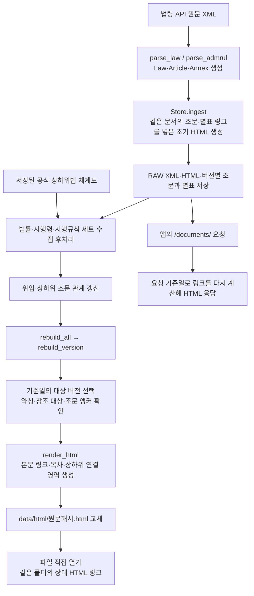

# 법령 HTML 생성과 조문·별표·상하위 법령 연결

이 문서는 LawRAG의 현재 코드를 기준으로 원문 XML에서 HTML을 만들고, 같은 법의 조문·별표와 다른 법령의 조문을 연결하는 과정을 설명합니다. 다른 프로젝트에서 재사용할 때 필요한 코드와 실행 방법도 포함합니다.

HTML 생성과 링크 판별은 Python 코드가 수행합니다. 이 과정에 LLM 추론이나 임베딩 검색은 사용하지 않습니다. 법령 수집 작업에는 조문 임베딩이 포함되지만, 저장된 자료의 HTML만 재생성할 때는 법령 API·AI API를 호출하지 않습니다.

## 1. 전체 처리 흐름



초기 HTML을 만드는 시점에는 다른 법령이 아직 수집되지 않았을 수 있습니다. 따라서 `Store.ingest()`와 세트 수집 후 HTML 재생성을 구분해야 합니다.

## 2. 코드 위치

| 파일 | 함수·영역 | 역할 |
| --- | --- | --- |
| [app/laws.py](../app/laws.py) | `parse_law()`, `parse_admrul()` | 원문 XML을 공통 문서 구조로 변환 |
| 같은 파일 | `HTML_REFERENCE_PATTERN`, `render_html()` | 조문·별표 표현 탐색, HTML 구성 |
| 같은 파일 | `render_html()` 내부 `annotated_body()` | 본문 참조에 실제 `<a>` 태그 생성 |
| 같은 파일 | `render_html()` 내부 `annotated_names()` | `「전체 법령명」`을 대상 문서로 연결 |
| [app/references.py](../app/references.py) | `parse_annexes()` | 별표 번호·제목·본문·원문 파일 주소 추출 |
| 같은 파일 | `reference_target()`, `reference_head()` | 참조 대상 법령 판별, 범위·열거의 생략된 법명 해석 |
| [app/graph.py](../app/graph.py) | `aliases()` | `이하 "법"이라 한다` 등의 약칭 선언 추출 |
| [app/document_links.py](../app/document_links.py) | `hierarchy_aliases()` | 공식 체계도에서 `법·영`의 기본 대상 확인 |
| 같은 파일 | `reference_resolver()` | 기준일에 맞는 다른 법령의 버전·조문·별표 조회 |
| 같은 파일 | `document_url()` | 파일용 상대 URL 또는 앱용 URL 생성 |
| [app/delegation.py](../app/delegation.py) | `refresh()`, `html_links()` | 관계 갱신 및 별도의 상하위 조문 연결 목록 생성 |
| [app/store.py](../app/store.py) | `Store.ingest()`, `temporal_versions()` | 원문·초기 HTML·DB 저장, 적용 버전 선택 |
| [app/management.py](../app/management.py) | `Management.run()` | 수집 후 관계 갱신과 관련 버전 HTML 재생성 |
| [app/rebuild_html.py](../app/rebuild_html.py) | `rebuild_version()`, `rebuild_all()` | 보관 XML로 HTML 파일 재생성 |
| [app/main.py](../app/main.py) | `document()` — `/documents/{filename}` | 앱에서 기준일을 반영한 HTML 제공 |
| [law_article_links.py](../law_article_links.py) | `xml_to_html()` | 단일 XML용 독립 변환기. 같은 문서 내부 연결만 지원 |

## 3. XML 파싱과 버전별 저장

법령은 `parse_law()`, 행정규칙은 `parse_admrul()`로 읽습니다. 주요 결과는 다음과 같습니다.

| 구조 | 주요 필드 |
| --- | --- |
| `Law` | 법령 ID, 이름, 시행일, 공포일, `version`, `articles`, `annexes`, 자료 구분 |
| `Article` | `number`, `title`, 전체 `body`, `section_id`, 상위 장·절 제목 |
| `Annex` | `number`, `title`, `body`, `section_id`, 공식 첨부파일 `source_url` |

`version`은 수신한 **원문 바이트의 SHA-256 해시 앞 20자리**입니다. 법령 API의 MST와는 별개이며, 동일한 버전 식별자로 DB·RAW·HTML을 연결합니다.

```text
data/
├─ laws.sqlite3
├─ raw/
│  └─ <version>.xml
└─ html/
   └─ <version>.html
```

| DB 테이블 | HTML 연결에 사용하는 정보 |
| --- | --- |
| `law_versions` | 법령명, 버전, MST, 시행일, 자료 구분, HTML 파일명 |
| `version_articles` | 버전별 조번호·제목·본문·앵커 |
| `annex_nodes` | 버전별 별표 번호·제목·본문·앵커·파일 주소 |
| `revision_catalog` | 알려진 개정 버전. 기준일 적용 버전의 미수집 여부 판단에 사용 |
| `law_hierarchy_snapshots` | 공식 법률·시행령·시행규칙 체계도 |
| `delegation_edges` 등 위임관계 테이블 | 확인된 상하위 조문 관계와 상태 |

`Store.ingest()`는 초기 HTML을 생성한 뒤 버전별 조문·별표 등을 DB에 저장합니다. 파일과 DB는 하나의 트랜잭션이 아니므로, 파일이 있다는 사실만으로 DB 수집 완료를 판단하지 않습니다.

## 4. 같은 법의 조문·별표 링크 생성

처리 위치는 `app/laws.py`의 `render_html()` 내부 `annotated_body()`입니다.

1. 현재 `Law`의 `articles`와 `annexes`로 번호별 조회 목록 `by_number`를 만듭니다.
2. `HTML_REFERENCE_PATTERN`으로 본문의 `제3조`, `제30조의2`, `별표 1`, `별표 1의2` 등을 찾습니다.
3. `reference_target()`으로 같은 법의 참조인지 확인합니다.
4. 같은 버전에 대상이 있고 제목이 있으며 자기 자신을 가리키는 참조가 아니면 내부 앵커 링크를 만듭니다.
5. 같은 문서 링크로 처리되지 않으면 외부 대상 조회 콜백인 `reference_resolver`를 호출합니다. 어느 쪽에서도 확인되지 않으면 원문 표기를 유지합니다.

앵커와 링크의 개념적 예시는 다음과 같습니다. 실제 `href`의 한글과 공백은 URL 인코딩합니다.

```html
<section id="예시법-제3조">...</section>
<section id="예시법-별표1">...</section>

<a href="#예시법-제3조">제3조(적용범위)</a>
<a href="#예시법-별표1">별표 1(검사 기준)</a>
```

`제3조제2항제1호`는 **제3조의 시작 위치**로 연결하고 뒤의 `제2항제1호` 표기는 보존합니다. 항·호마다 별도 앵커를 만들어 이동하는 구조는 아닙니다. 별표 본문 안에 있는 조문·별표 참조에도 같은 함수를 적용합니다.

API의 별표번호 `0` 또는 `000000`은 번호 없는 별표입니다. 내부 키는 `별표 0`, 앵커는 `법령명-별표0`으로 유지하되 화면에는 `별표`로 표시합니다. `별표와 같다`는 이 대상이 있을 때 연결하며, 번호 있는 별표 1로 임의 연결하지 않습니다.

HTML은 제목·본문을 이스케이프하고 코드가 확인한 위치에만 링크를 삽입합니다. 목차와 문서 CSS도 함께 생성하며, 파일을 열 때 링크 생성을 위한 JavaScript나 API 호출이 필요하지 않습니다.

## 5. 시행령·시행규칙의 `법·영`을 다른 HTML로 연결

### 5.1 참조 앞의 문맥 판별

`app/references.py`의 `reference_target()`이 참조 앞의 문맥을 읽습니다.

| 본문 표현 | 해석 |
| --- | --- |
| `이 법 제3조`, `이 영 제3조` | 현재 문서 |
| `법 제3조`, `영 제7조` | 약칭 대상 확인 필요 |
| `시행령 제7조`, `시행규칙 제2조` | 해당 명칭의 대상 확인 필요 |
| `「선박안전법」 제3조` | 명시된 전체 법령명 |
| `법 제4조부터 제11조까지` | 뒤의 제11조도 앞의 `법`을 이어받음 |
| 대상이 불분명한 `같은 법` 등 | 확인되지 않으면 외부 링크를 만들지 않음 |

표준 약칭은 `영`이며, `reference_target()`의 일반 약칭 패턴은 `법·영·규칙·시행령·시행규칙`입니다. 모든 임의 약칭이나 `령` 표기를 자동으로 해석하는 것은 아닙니다.

### 5.2 약칭을 전체 법령명으로 변환

`app/document_links.py`의 `reference_resolver()`는 다음 자료를 결합합니다.

1. `hierarchy_aliases()`가 저장된 공식 체계도에서 현재 문서의 조상을 찾습니다. 법률 또는 시행령의 대상 이름이 유일할 때만 기본 `법`, `영`, `시행령` 매핑을 만듭니다.
2. `app/graph.py`의 `aliases()`가 현재 문서 전체 조문에서 선언을 추출합니다.
3. **본문의 명시적 약칭 선언이 공식 체계도의 기본 매핑보다 우선**합니다. 같은 약칭이 여러 법을 가리키면 임의로 하나를 고르지 않습니다.

```text
「선박안전법」(이하 "법"이라 한다)
    → 법 = 선박안전법

「선박안전법 시행령」(이하 "영"이라 한다)
    → 영 = 선박안전법 시행령
```

`aliases()`는 문서에 실제로 선언된 대응 관계를 추출하는 함수입니다. HTML 연결 전체가 `graph.expand()`를 실행하는 것은 아닙니다.

### 5.3 기준일의 대상 버전과 조문 조회

`reference_resolver()`가 반환하는 `Resolver.__call__()`의 처리 순서입니다.

1. `reference_target()` 결과를 약칭 매핑으로 해석합니다.
2. `Store.temporal_versions(as_of)`로 기준일 적용 버전들을 가져옵니다.
3. 정규화된 전체 법령명이 일치하는 대상이 유일한지 확인합니다.
4. 조문이면 `version_articles`, 별표이면 `annex_nodes`에서 **대상 버전 + 번호**로 조회합니다.
5. 대상의 제목·앵커·HTML 파일명으로 URL을 만들어 렌더러에 돌려줍니다.

현재 외부 문서 대상 목록은 `kind='law'`로 구성합니다. 법률·시행령·시행규칙이 여기에 포함됩니다. 모든 행정규칙 간 교차 연결까지 자동 지원하는 것은 아닙니다.

예를 들어 시행규칙의 `법 제3조제3항`은 다음 형태가 됩니다.

```html
법 <a href="<법률버전>.html#선박안전법-제3조"
      title="선박안전법">제3조(적용범위)</a>제3항
```

이는 형태 설명용 예시이며 실제 URL은 인코딩됩니다. 선언부의 `「선박안전법」` 전체 이름도 `annotated_names()`와 `Resolver.law_name()`을 통해 문서 첫 위치로 연결할 수 있습니다.

기준일에 필요한 개정 버전이 알려져 있지만 본문이 미수집이면, 이전 버전으로 임의 대체하지 않습니다. 대상이 불명확하거나 해당 조문이 없으면 링크 없이 원문 표현을 남깁니다.

## 6. 본문 링크와 별도의 상하위 연결 영역

본문의 `법 제3조` 같은 인용 링크와, 조문 아래에 표시하는 **상하위 조문 연결** 영역은 별도 경로입니다.

- 본문 인용 링크: `reference_resolver()`가 원문 표현을 해석합니다.
- 상하위 연결 영역: `app/delegation.py`의 `html_links()`가 기준일에 유효한 저장 관계를 읽고, 상위·하위 방향의 연결 목록을 만듭니다.
- `render_html()`은 이 목록을 받아 `<aside class="delegation-links">`에 표시합니다.

HTML에는 한 단계의 양방향 연결을 표시합니다. 관계가 위임조문 비교이면 `상위/하위 위임조문 비교`, 본문 인용이면 `상위/하위 인용 조문`으로 구별합니다. 비교표의 같은 행에 있다는 사실만으로 모든 조문 사이에 직접 위임 관계가 있다고 표시하지 않습니다.

관계 조회·매핑의 상세는 [위임관계 문서](delegation.md)를 참고하세요.

## 7. 초기 저장과 세트 완료 후 재생성

일반 수집 흐름은 `app/management.py`의 `Management.run()`이 담당합니다.

1. API 원문 수신·보관, 문서 이름과 시행 버전 검증.
2. `Store.ingest()`로 조문·별표·벡터·초기 HTML 저장.
3. 본문 수집 작업을 마친 뒤 수집 완료 버전과 수집 계획에 포함된 기존 저장 버전을 모음.
4. `delegation.refresh()`로 상하위 관계 조회·매핑.
5. `rebuild_all(..., versions=versions)`로 관련 버전의 정적 HTML 재생성.

`app/preload_maritime.py`도 개별 본문 수집 시에는 `with_relations=False`로 진행하고, 해당 세트 처리 후 `manager.run([], plan_id=...)`으로 관계·HTML 후처리를 수행합니다. 이때 `HTML 링크 생성 완료 … · 실패 …` 결과를 출력합니다.

따라서 **개별 법령의 본문 수집 완료와 세트의 HTML 링크 생성 완료는 다를 수 있습니다.** 초기 법령 HTML에는 링크 준비 중 안내가 들어갑니다. `Store.ingest()`만 별도로 호출하는 프로그램이라면 세트 후처리 또는 HTML 재생성을 명시적으로 실행해야 합니다.

법률만 개정되고 시행령·시행규칙은 그대로인 경우, 이미 있는 하위법 본문과 벡터를 다시 만들 필요는 없습니다. 새 법률을 저장한 뒤 기존 하위법 HTML의 참조 대상을 다시 계산합니다. 자동 후처리는 해당 수집 작업·계획의 관련 버전들에 적용되므로 다른 세트까지 포함한 저장 HTML 전체를 갱신하려면 `app.rebuild_html`을 실행합니다.

## 8. 직접 여는 HTML과 앱에서 여는 HTML

| 항목 | `data/html` 파일 직접 열기 | 앱의 `/documents/{filename}` |
| --- | --- | --- |
| 생성 위치 | `rebuild_version()` | `app/main.py`의 `document()` |
| 외부 링크 | `<대상버전>.html#앵커` | `/documents/<대상버전>.html?as_of=YYYY-MM-DD#앵커` |
| 기준일 | 재생성할 때 확정 | 요청의 `as_of` 우선 |
| 기준일 생략 | 현행 저장 버전이면 한국 기준 오늘, 과거 버전이면 그 문서 시행일 | 동일한 기본 규칙 |
| 다른 자료가 추가된 후 | 저장 HTML 재생성 필요 | 법령 문서는 요청 시 저장 자료로 참조 재계산 |
| 파일 배포 | 연결된 HTML을 같은 폴더에 함께 배포 | 서버의 DB·RAW·HTML로 제공 |

두 경로 모두 **현재 열고 있는 문서 자체의 원문 버전은 바꾸지 않습니다.** 기준일은 다른 법령의 참조 대상을 선택하는 데 사용합니다.

앱에서는 법령(`kind='law'`)의 RAW가 있으면 요청 기준일로 HTML 응답을 다시 구성하며 `Cache-Control: no-store`를 사용합니다. 이 응답이 곧바로 디스크의 정적 HTML을 같은 내용으로 덮어쓰는 것은 아닙니다. 뷰어 버전이 오래된 경우의 파일 업그레이드는 별도 처리입니다. 현재 행정규칙은 같은 문서 내부 링크를 포함한 저장 HTML을 제공하는 경로를 사용합니다.

## 9. HTML만 다시 생성하기

기존 수집을 마친 뒤 프로젝트 루트에서 실행합니다.

```powershell
# .env / local.env의 DATA_DIR에 있는 수집 자료 사용
.\.venv\Scripts\python.exe -m app.rebuild_html

# 다른 저장 폴더를 명시할 경우
.\.venv\Scripts\python.exe -m app.rebuild_html --data-dir "D:\LawRAG-data"
```

Linux/macOS에서는 `.venv/bin/python -m app.rebuild_html`을 사용합니다. `DATA_DIR` 설정의 우선순위는 프로세스 환경변수, `local.env`, `.env` 순입니다.

`rebuild_all()`은 DB에 등록된 버전 목록을 읽고 `rebuild_version()`을 호출합니다. 각 파일에 대해 다음을 검증합니다.

1. 버전이 20자리 16진수인지, HTML 파일명이 해당 버전과 일치하는지 확인.
2. RAW XML 존재 여부와 SHA-256 해시 확인.
3. 원문 재파싱 후 기준일·참조 대상·상하위 링크 계산.
4. 같은 폴더의 임시 파일에 UTF-8 HTML 작성.
5. 작성이 끝나면 기존 HTML을 원자적으로 교체.

DB는 `ReadOnlyStore`로 읽으므로 조문·벡터·수집 이력·관계 테이블을 변경하지 않습니다. 다만 없는 체계도나 위임관계를 새 API 조회로 보완하는 명령은 아닙니다. RAW가 없거나 검증이 실패한 버전은 기존 HTML을 유지하고 실패 사유를 출력합니다. 하나라도 실패하면 종료 코드는 1입니다.

## 10. 다른 코드에서 재사용하기

### LawRAG의 저장 자료를 사용해 전체 재생성

LawRAG 패키지를 import할 수 있는 환경에서 실행합니다.

```python
from app.config import Settings
from app.rebuild_html import rebuild_all

report = rebuild_all(Settings().data_dir)
print(report["completed"], report["failed"])
for error in report["errors"]:
    print(error["version"], error["reason"])
```

이 경로는 LawRAG의 DB 스키마·RAW 파일·모듈에 의존합니다. 회사 LLM 연결이나 API 키는 HTML 재생성에 필요하지 않습니다.

### 단일 XML만 가지고 같은 문서 내부 연결

루트의 `law_article_links.py`는 Python 3.10 이상에서 표준 라이브러리만으로 사용하는 독립 파일입니다.

```powershell
python law_article_links.py law.xml -o law.html
```

```python
from pathlib import Path
from law_article_links import xml_to_html

page = xml_to_html(Path("law.xml").read_bytes())
Path("law.html").write_text(page, encoding="utf-8")
```

입력은 법령 본문 API의 XML 한 건입니다. 검색 목록 XML·행정규칙·별표 첨부파일 자체는 지원하지 않습니다. 같은 XML 안의 조문·별표끼리 연결하며, `법·영`을 해석해 다른 법령 HTML로 연결하는 기능은 포함하지 않습니다.

다른 프로젝트에 문서 간 연결까지 옮기려면 `reference_resolver()`의 저장소 의존 부분을 해당 시스템에 맞게 바꿔야 합니다. 최소한 **법령명·기준일 → 유일한 버전**, **버전·조번호/별표번호 → 제목·앵커**, **버전 → HTML 위치**, **약칭 선언·공식 상하위 관계**를 조회할 수 있어야 합니다.

## 11. 링크가 없거나 본문이 보이지 않을 때

| 현상 | 확인할 지점 |
| --- | --- |
| 같은 법의 조문 링크 없음 | 파싱 결과에 대상 번호·제목이 있는지, 자기 참조인지, 다른 법령 표현으로 판별됐는지 |
| `법 제3조` 또는 `영 제7조` 링크 없음 | 약칭 선언, 공식 체계도 저장 여부, 기준일 대상 버전·조문 수집 여부 |
| 앱에서는 연결되지만 파일 직접 열기는 안 됨 | 세트 후처리 완료 여부, `app.rebuild_html`로 정적 HTML 갱신 여부 |
| 링크는 있는데 파일을 찾을 수 없음 | 연결 대상 HTML을 삭제했거나 다른 폴더로 옮겼는지. DB의 대상 조회만으로 실제 파일 존재가 보장되지는 않음 |
| 상하위 연결 영역 없음 | 위임관계 조회·매핑 상태와 기준일에 유효한 저장 관계 확인 |
| 별표 링크는 있지만 표의 수치가 없음 | XML 별표 텍스트가 확보됐는지, 원문 파일 링크만 있는지 확인 |
| 재생성 실패 | DB·RAW 경로, 원문 해시, 버전별 실패 사유 확인 |

별표 PDF/HWP 다운로드와 이미지 OCR은 현재 HTML 생성 과정에 포함되지 않습니다. 파서는 추출 가능한 XML 텍스트와 공식 파일 주소를 구분해서 보관합니다. 파일 주소나 HTML 이미지·표 등만 남아 텍스트로 확보되지 않은 별표는 본문 미확보 안내와 원문 링크를 표시합니다.

HTML의 이동 링크, 채팅의 근거 검색·참조 본문 확장, 답변 화면의 숫자/C 인용 버튼은 서로 다른 처리 단계입니다. HTML에 별표 링크가 생겼다는 사실만으로 별표 내용이 추출되거나 최종 LLM 입력에 포함됐다고 판단하지 않습니다.
