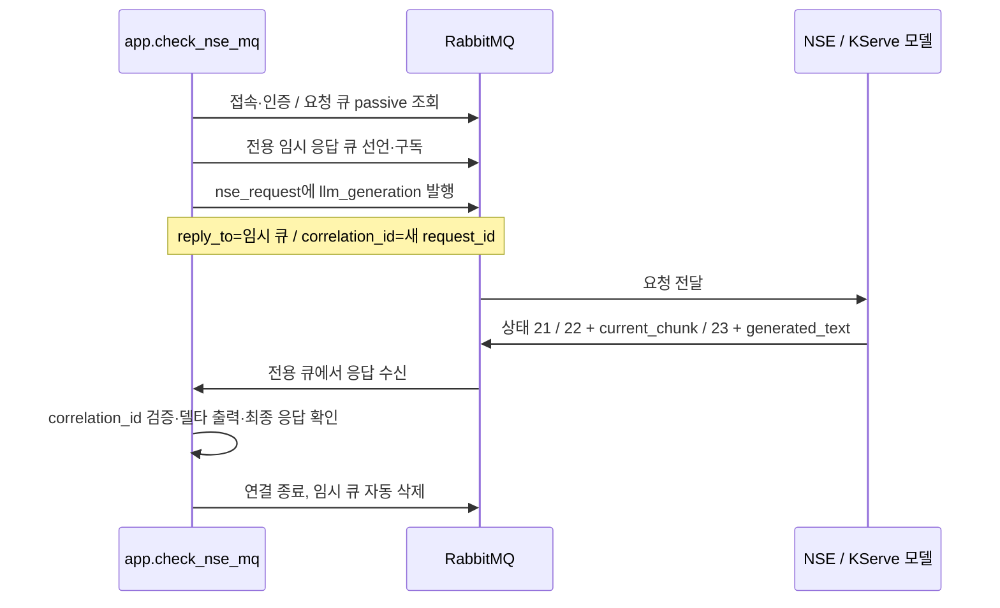

# NSE RabbitMQ 채팅·임베딩 연결과 통신 점검

첨부 `nse_mq_ref`, `STREAMING.md`, `nse_embedding_ref`의 규약을 사용합니다. **독립 실행 진단 명령**은 HTTP를 거치지 않고 RabbitMQ로 요청 한 건을 보내 일반 응답·스트리밍·임베딩을 각각 확인합니다. 진단은 OpenAI 키·법령 API·법령 DB를 사용하지 않고 설정도 변경하지 않습니다. 동일한 MQ 클라이언트는 웹 채팅의 `LOCAL_MODEL`과 수집·검색의 `LOCAL_EMBEDDING`에서 사용합니다.

## 1. 코드 업데이트와 접속 설정

회사 MQ에 접근 가능한 PC에서 PowerShell로 실행합니다. 기존 웹 서버를 켜 둔 채 별도 PowerShell에서 점검해도 됩니다.

```powershell
git pull --ff-only origin main
if ($LASTEXITCODE -ne 0) { throw "git pull 실패" }
.\.venv\Scripts\python.exe -m pip install -r requirements.txt
if ($LASTEXITCODE -ne 0) { throw "의존성 설치 실패" }
if (!(Test-Path local.env)) { Copy-Item local.env.example local.env }
notepad local.env
```

**기존 `local.env`는 덮어쓰지 않습니다.** 아래 MQ 항목을 추가하거나 수정하세요. 기존 `CHAT_BACKEND`, `EMBEDDING_BACKEND`는 유지합니다. 설정 우선순위는 프로세스 환경변수 > `local.env` > `.env`입니다.

```dotenv
# 첨부 mq_config.py 또는 담당자가 제공한 실제 AMQP 호스트를 입력
NSE_MQ_HOST=실제_MQ_호스트
NSE_MQ_PORT=35672
NSE_MQ_VHOST=/
NSE_MQ_USERNAME=실제_계정
NSE_MQ_PASSWORD='실제_비밀번호'
NSE_MQ_TLS=false

# 환경별 suffix가 없다면 nse_request
NSE_MQ_REQUEST_QUEUE=nse_request
# 매 요청마다 nse_result_kih_<고유ID>를 생성해 기존 구독자와 분리
NSE_MQ_REPLY_PREFIX=nse_result_kih

# tb_dap_physical_model.physical_model_id의 실제 숫자 ID
NSE_PHYSICAL_MODEL_ID=22
NSE_MAX_TOKENS=4096
NSE_EMBEDDING_MODEL=emb-bge-m3-ko
NSE_EMBEDDING_REVISION=
# 환경에서 요구할 때만 지정
NSE_DOMAIN_ID=1
NSE_USER_ID=1
```

`35672`는 첨부 개발 환경 설정의 AMQP 포트입니다. 다른 환경에서는 실제 포트로 바꾸세요. HTTP 예시의 `41007`이나 RabbitMQ 관리 웹 포트와는 다릅니다. **모델 ID `22`는 HTTP 예시 값**이며 ZIP의 시험 스크립트는 `34`를 사용하므로 실제 대상 모델을 확인해서 지정해야 합니다. 접속만 점검할 때는 모델 ID가 없어도 됩니다.

첨부 파일의 계정 기본값은 비어 있습니다. `NSE_MQ_USERNAME`, `NSE_MQ_PASSWORD`를 모두 비워두면 `~/.netrc`, Windows에서는 `~/_netrc`도 확인합니다. 해당 호스트의 `machine … login … password …` 항목을 사용합니다. 별도 파일은 `NSE_MQ_NETRC=C:/경로/.netrc`로 지정합니다. 사용자명만 입력한 경우 다른 netrc 계정의 비밀번호와 섞어 사용하지 않습니다.

TLS 포트라면 `NSE_MQ_TLS=true`를 사용합니다. 내부 CA가 필요한 경우 `NSE_MQ_CA_FILE=C:/certs/company-ca.pem`을 지정합니다. 인증서 검증을 끄는 옵션은 없습니다.

요청 큐 이름은 다음 순서로 결정합니다.

1. `NSE_MQ_REQUEST_QUEUE`가 있으면 그대로 사용합니다.
2. 없으면 `NSE_MQ_SUFFIX`, 그 값도 없으면 기존 `SUFFIX`를 사용해 `nse_request_접미사`를 만듭니다. 첨부 코드와 같이 접미사의 `-`는 `_`로 바꿉니다.
3. 접미사도 없으면 `nse_request`입니다.

## 2. 순서대로 실행

**접속·인증·요청 큐 존재 여부만 확인**합니다. LLM 요청을 발행하지 않습니다.

```powershell
.\.venv\Scripts\python.exe -m app.check_nse_mq --connect-only
```

접속이 성공하고 소비자가 1개 이상이면 **일반 응답 한 건**을 확인합니다. 기본 시험 질문은 “대한민국의 수도를 한 문장으로 알려주세요.”입니다.

```powershell
.\.venv\Scripts\python.exe -m app.check_nse_mq
```

**실제 스트리밍**을 확인합니다. 생성 중 도착한 누적 텍스트에서 새 부분을 출력하고 수신 상태·청크 수·첫 청크까지 걸린 시간을 표시합니다. 일반적인 상태는 `START(21) → STREAMING(22) → END(23)`지만 두 조각이면 `21 → 23`도 정상입니다. 한 조각짜리는 END만 오므로 이 경우 최종 응답 수신과 실시간 스트리밍 확인을 구분합니다. `stream_unconfirmed`가 나오면 더 긴 답변을 요청해 다시 확인하세요.

```powershell
.\.venv\Scripts\python.exe -m app.check_nse_mq --stream
```

LawRAG의 질문 재작성·근거 검토에 필요한 **JSON 생성**도 추가 점검할 수 있습니다. 이 명령은 `{"ok":true}`만 생성하라는 고정 질문으로 바꿔서 전송합니다. 연결 성공과 모델의 JSON 생성 성공을 구분합니다.

```powershell
.\.venv\Scripts\python.exe -m app.check_nse_mq --json
```

**임베딩 요청**은 시험 문장 2개를 보내 입력 수·벡터 수·차원·숫자 유효성을 확인합니다. LLM의 `physical_model_id` 없이도 실행할 수 있습니다. 원시 벡터는 출력하지 않습니다.

```powershell
.\.venv\Scripts\python.exe -m app.check_nse_mq --embedding
```

다른 임베딩 모델은 `--embedding-model emb-bge-m3-ko`처럼 이름으로 지정합니다. 이 명령은 앱의 임베딩 설정이나 기존 DB를 바꾸지 않습니다.

선택 옵션 예시입니다. `--model`은 이번 실행에만 적용하고 파일을 수정하지 않습니다.

```powershell
.\.venv\Scripts\python.exe -m app.check_nse_mq --stream --model 22 --timeout 180 --max-tokens 256
```

성공 종료 코드는 `0`, 실패는 `1`, Ctrl+C 중단은 `130`입니다. 확인은 `$LASTEXITCODE`로 합니다. 생성 요청은 각 명령당 **한 건**, 기본 출력 상한은 128토큰이며 자동 재발행하지 않습니다. 준비된 모델이 없어 느리다면 `--timeout`을 늘릴 수 있습니다. 타임아웃·Ctrl+C가 이미 시작된 NSE 추론까지 취소하지는 않습니다.

## 3. 결과 확인

매 실행 결과를 `data/nse-mq-check.json`에 덮어씁니다. 다른 파일은 `--report data/stream-check.json`으로 지정할 수 있습니다. 보고서에는 성공 여부, 실패 단계, 서버 로그 조회용 `request_id`, 큐 소비자 수, 수신 건수, 청크 수, 상태 번호, 시간만 남깁니다. **계정·호스트·질문·답변·서버 원본 오류는 저장하지 않습니다.** 생성된 답변은 실행 콘솔에서 확인합니다.

| 실패 단계 | 확인할 내용 |
| --- | --- |
| `config` | `local.env`/netrc, 모델 숫자 ID, 설정 형식 |
| `connect` / `auth` | 회사망·VPN, DNS, AMQP 포트, TLS, 계정, 가상 호스트 |
| `queue` | 큐 이름·접미사, NSE 소비자 실행 여부. 소비자 0개면 생성 요청을 보내지 않음 |
| `subscribe` | `nse_result_kih_*` 임시 큐 생성·구독 권한 |
| `publish` | 발행 권한·브로커 발행 확인. 불명확한 전송을 자동 반복하지 않음 |
| `timeout` | 모델 로딩·처리 지연, NSE 로그, 서버의 응답 큐 발행 권한 |
| `server` | NSE 실패 응답. 보고서의 `request_id`로 서버 로그 확인 |
| `response` / `stream` | 응답 스키마, correlation_id, 상태 번호, 청크 순서·최종 결과 일치 여부 |
| `stream_unconfirmed` | 정상 최종 응답은 받았으나 생성 중 청크는 관찰하지 못함. 한 조각 답변일 수 있으므로 더 긴 시험 질문으로 확인 |
| `json` | MQ 응답은 받았지만 모델이 요구된 JSON 객체를 생성하지 못함 |
| `embedding` | 입력 수와 벡터 수, 3단 배열 구조, 차원 일치, NaN·무한대·영벡터 여부 |

## 4. 통신 구조와 코드



비스트리밍은 `content.generated_text` 한 건으로 완료합니다. 스트리밍 청크에도 `generated_text`가 누적 본문으로 들어오므로, 화면은 이 값으로 덮어씁니다. 같은 전용 큐를 청크·최종 응답에 사용하며, **그 큐의 최종 END**로 완료를 판단합니다. 최종 응답에만 실린 마지막 조각도 보존하고, 반복된 `current_chunk`를 두 번 더하지 않습니다. 다른 `correlation_id`의 메시지는 출력하지 않습니다. `result_status.code`가 `SUCCESS`가 아니거나 빈 최종 답변이면 실패로 처리합니다.

[nse_mq.py](../app/nse_mq.py)는 접속 설정·본문 생성·응답 해석·임시 큐 수명 관리를 담당하고, [check_nse_mq.py](../app/check_nse_mq.py)는 실행 옵션·콘솔 출력·진단 보고서를 담당합니다. 첨부 common 모듈 전체나 Kubernetes SDK 없이 `pika`로 실행합니다. 공유 요청 큐를 삭제·비우거나 서버 토폴로지를 재선언하지 않습니다.

## 5. 웹에서 GPT와 LOCAL_MODEL 선택

기존 GPT를 기본값으로 유지하려면 `CHAT_BACKEND=openai`를 그대로 둡니다. 위 MQ 접속정보와 모델 ID가 갖춰지면 웹 채팅의 모델 목록에 **`LOCAL_MODEL`이 추가**됩니다. `gpt-4.1` 등 GPT를 고르면 기존 HTTP API로, `LOCAL_MODEL`을 고르면 NSE MQ로 요청합니다. `LOCA_MODEL`로 직접 입력해도 같은 모델로 연결합니다. 회사 OpenAI 호환 서버의 `CHAT_BACKEND=company` 방식도 유지됩니다.

MQ를 기본 모델로 시작하려면 다음 값만 바꾸세요. 이 경우에도 목록에서 GPT를 고를 수 있고, 기존 `.env`의 OpenAI 설정을 사용합니다.

```dotenv
CHAT_BACKEND=local_model
EMBEDDING_BACKEND=openai
```

서버를 재시작합니다.

```powershell
.\.venv\Scripts\python.exe -m app.serve --lan
```

질문 재작성·관련성 검토·근거 충분성 검토는 선택한 모델에 `stream=false`로 요청하고 기존 JSON 검증을 적용합니다. `LOCAL_MODEL`의 최종 답변은 `stream=true`로 요청하며, FastAPI가 누적 답변을 NDJSON으로 브라우저에 전달합니다. 생성 도중에는 화면만 갱신하고, 완료 후 답변과 출처를 대화 이력에 저장합니다. 오류로 끝나면 부분 답변을 정상 답변으로 저장하지 않습니다. GPT의 기존 처리 단계 표시·완료 응답 방식은 유지합니다.

응답 큐는 **매 요청마다 `nse_result_kih_<UUID>`**이며 `exclusive=true`, `auto_delete=true`, `durable=false`입니다. 기존 `nse_result`/`nse_response` 등 공유 큐를 소비하지 않습니다. 두 사용자의 요청과 동시에 실행되는 근거 검토도 별도 큐를 사용합니다. 해당 접두사에 대한 생성·구독 권한과 NSE의 응답 발행 권한이 필요합니다.

채팅 모델만 바꾸면 재수집·재임베딩이 필요 없습니다. VLM 호출은 `llm_generation`의 텍스트 메시지만 사용하며 이미지 입력은 포함하지 않습니다. 임베딩 모델도 바꾸려면 아래 절차를 따릅니다.

연결 종료 시 클라이언트는 수신을 중단하고 임시 큐를 정리합니다. 첨부 문서의 Redis 취소 요청은 연결 정보가 없어 구현하지 않았으므로 이미 시작된 추론은 서버에서 계속 진행될 수 있습니다. 또한 첨부 규약에는 추론 실패인데 `SUCCESS`와 일부 텍스트만 반환할 가능성이 명시되어 있습니다. 실패 상태·빈 응답·누적 불일치는 거르지만, 서버가 정상 성공과 같은 형태로 잘린 답을 반환하면 이 규약만으로 완전성을 판별할 수 없습니다.

## 6. LOCAL_EMBEDDING 선택과 기존 자료 전환

채팅과 임베딩은 서로 독립적입니다. 다음 네 조합을 모두 지원합니다.

| 채팅 | 임베딩 | 서버 설정 |
| --- | --- | --- |
| GPT | OpenAI | `CHAT_BACKEND=openai`, `EMBEDDING_BACKEND=openai` |
| GPT | NSE MQ | `CHAT_BACKEND=openai`, `EMBEDDING_BACKEND=local_embedding` |
| NSE MQ | OpenAI | `CHAT_BACKEND=local_model`, `EMBEDDING_BACKEND=openai` |
| NSE MQ | NSE MQ | `CHAT_BACKEND=local_model`, `EMBEDDING_BACKEND=local_embedding` |

`LOCAL_EMBEDDING`, `LOCA_EMBEDDING` 대문자 표기도 `EMBEDDING_BACKEND`에서 허용합니다. 기존 방식의 `EMBEDDING_MODEL=LOCAL_EMBEDDING` 또는 `LOCA_EMBEDDING`도 `openai` 기본 백엔드에서 MQ 선택으로 해석합니다. 혼동을 피하려면 `EMBEDDING_BACKEND=local_embedding` 방식으로 설정하고 기존 OpenAI 모델명은 유지하세요.

```dotenv
# 채팅은 기존 GPT를 기본값으로 유지하는 예시
CHAT_BACKEND=openai
EMBEDDING_BACKEND=local_embedding
NSE_EMBEDDING_MODEL=emb-bge-m3-ko
NSE_EMBEDDING_REVISION=
```

임베딩 요청은 `task=embedding`, `content.texts`, `content.served_model_name`만 사용합니다. LLM의 `physical_model_id`, `stream`, `infer_argument`를 보내지 않습니다. 응답 `embedding_vectors[i][0]`을 i번째 입력 벡터로 읽고 공통 수집·검색 처리로 전달합니다. 한 요청의 입력 수와 벡터 수가 다르거나, 비정상 수치·차원 불일치가 있으면 실패 처리합니다. 앱은 기존처럼 최대 16개 입력씩 보내고 긴 본문은 설정한 바이트 단위로 분할합니다. 임베딩도 `nse_request` → `nse_result_kih_<UUID>`를 사용하며 NSE의 VectorDB 저장 task는 호출하지 않습니다. 저장소는 기존 LawRAG SQLite입니다.

**임베딩을 바꾸면 기존 벡터를 재사용할 수 없습니다.** 기존 앱 서버와 수집 작업을 먼저 종료하고 `local.env`를 수정한 뒤 다음 순서로 실행합니다.

```powershell
.\.venv\Scripts\python.exe -m app.check_nse_mq --embedding
if ($LASTEXITCODE -ne 0) { throw "MQ 임베딩 연결 확인 실패" }
.\.venv\Scripts\python.exe -m app.reindex_embeddings
if ($LASTEXITCODE -ne 0) { throw "재색인 실패 항목을 확인하고 같은 명령으로 재개하세요" }
.\.venv\Scripts\python.exe -m app.serve --lan
```

재색인은 RAW·HTML을 다시 수집하지 않고 저장된 모든 버전의 제목·본문 벡터를 교체합니다. 버전 하나의 임베딩이 모두 성공해야 DB를 갱신하고 실패한 버전은 기존 벡터를 보존합니다. 같은 명령으로 재개하면 완료된 버전은 건너뜁니다. 기존 자료가 없는 경우에는 재색인 대신 평소 수집 명령을 사용합니다.

NSE 벡터 식별자는 MQ 환경·가상 호스트·요청 큐·모델명·리비전과 입력 분할 크기를 반영합니다. OpenAI 벡터와 혼용하지 않으며, 채팅 모델이나 응답 큐의 UUID 변경은 식별자에 영향을 주지 않습니다. 같은 `served_model_name` 뒤의 모델 가중치를 교체했다면 `NSE_EMBEDDING_REVISION`을 새 값으로 바꾼 뒤 재색인하세요. OpenAI로 되돌릴 때도 재색인이 필요합니다. 두 공간을 모두 보관하려면 별도 `DATA_DIR`를 사용하세요.
